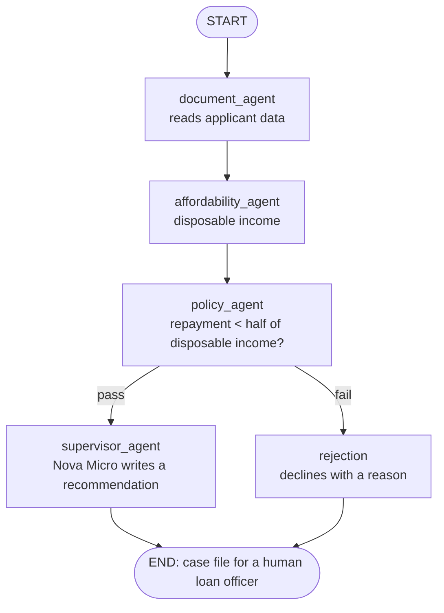

# Agentic Loan Assistant

An AI loan application assistant built with **LangGraph** and **Amazon Bedrock**, deployed to **AWS Bedrock AgentCore** with **Terraform**.

📺 **Watch the build:** [Part 1 on YouTube](YOUTUBE_LINK) · TechWithAlok

> **Part 1** keeps it to a single agent. Part 2 adds a document agent (multi-agent) and memory with human-in-the-loop approval.

## How it works

A loan application flows through a LangGraph workflow. Only **one step uses AI**. The maths and policy rules are plain Python, because in a bank you want calculations to be exact, repeatable and auditable. A human always makes the final decision.



| Step | Type | What it does |
|---|---|---|
| `document_agent` | Code (mocked in Part 1) | Provides monthly income and outgoings |
| `affordability_agent` | Code | Works out disposable income |
| `policy_agent` | Code | Checks the repayment against the lending rule |
| `supervisor_agent` | **LLM** (Amazon Nova Micro) | Writes a 2–3 sentence recommendation for a human |
| `rejection` | Code | Declines with the policy reason, with no model call |

Every step appends to an `audit_log`, so you can see exactly what ran.

## Project layout

```
.
├── agent.py                     # AgentCore entrypoint (BedrockAgentCoreApp)
├── src/agentic_loan_assistant/
│   ├── state.py                 # LoanState: the case file
│   └── graph.py                 # Nodes, edges and the compiled graph
├── scripts/build.sh             # Builds dist/agent.zip for Linux ARM64
├── infra/                       # Terraform: S3, IAM, AgentCore runtime
├── pyproject.toml
└── uv.lock
```

## Prerequisites

- Python 3.12+ and [uv](https://docs.astral.sh/uv/)
- AWS CLI v2, signed in to an account with Amazon Bedrock access to **Amazon Nova Micro** in `us-east-1`
- Terraform 1.6+

## Run it locally

Run the graph on its own:

```bash
uv sync
uv run python -m agentic_loan_assistant.graph
```

Or run it behind the same HTTP contract AgentCore uses (port 8080):

```bash
uv run python agent.py
```

In another terminal:

```bash
# Approved path: the supervisor calls Nova Micro
curl -X POST http://localhost:8080/invocations \
  -H "Content-Type: application/json" \
  -d '{"application_id": "A1", "loan_amount": 10000}'

# Declined path: no model call
curl -X POST http://localhost:8080/invocations \
  -H "Content-Type: application/json" \
  -d '{"application_id": "A2", "loan_amount": 50000}'
```

## Deploy to AgentCore with Terraform

**1. Build the zip.** AgentCore runs on Linux ARM64, so the script installs ARM64 wheels and flattens the package next to `agent.py`:

```bash
./scripts/build.sh
```

**2. Deploy:**

```bash
cd infra
terraform init
terraform plan -out=tfplan
terraform apply tfplan
```

This creates a versioned S3 bucket holding `agent.zip`, a least-privilege IAM role (Nova Micro, the zip, logs and traces only), and the AgentCore runtime.

**3. Invoke it in AWS:**

```bash
aws bedrock-agentcore invoke-agent-runtime \
  --agent-runtime-arn "$(terraform output -raw agent_runtime_arn)" \
  --runtime-session-id "demo-session-approve-0001-$(date +%s)" \
  --payload '{"application_id": "A1", "loan_amount": 10000}' \
  --cli-binary-format raw-in-base64-out \
  --region us-east-1 \
  response.json && cat response.json
```

The session ID must be at least 33 characters long.

## Clean up

```bash
cd infra
terraform destroy
```

Run this when you're done, so nothing is left running in your account.

## Gotchas covered in the video

- **ARM64 packaging:** wheels built for macOS or x86 crash on AgentCore. `build.sh` uses `--python-platform aarch64-manylinux_2_28`.
- **Flat layout:** AgentCore runs `agent.py` directly, so the package must sit beside it in the zip.
- **`aws-opentelemetry-distro` is required:** AgentCore starts your code with `opentelemetry-instrument`.
- **S3 bucket names can't contain underscores**, while AgentCore runtime names can't contain hyphens.
- **Address already in use on 8080:** an old local run is still listening. Use `lsof -i :8080` to find it, then `kill` it.

## Cost

Nova Micro is one of the cheapest models on Bedrock, so a demo run costs fractions of a penny. AgentCore charges while sessions are running, not for an idle runtime. Prices change, so check the AWS pricing pages.

## Roadmap

- [x] Part 1: single-agent workflow, deployed to AgentCore with Terraform
- [ ] Part 2: document agent that reads the payslip and bank statement (multi-agent)
- [ ] Part 2: memory, pausing for missing documents with human-in-the-loop approval

---

Built by [TechWithAlok](https://www.youtube.com/@tech-with-alok). This is a learning project, not financial advice or a production lending system.
